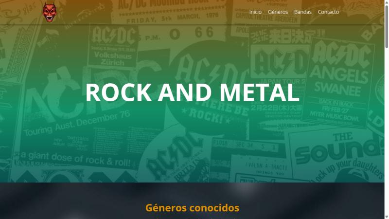
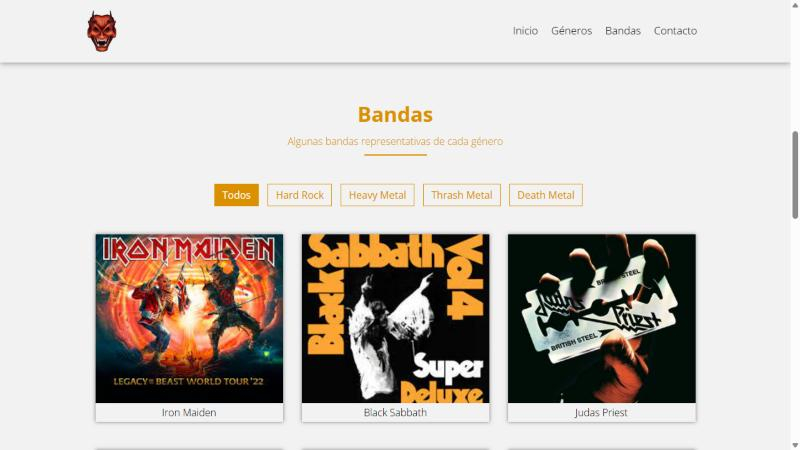

<div align="center">

# Rock and Metal

**Mi primera página web: un recorrido por los géneros y las bandas más representativas del rock y el metal.**

[](https://kesagaro.github.io/Primera-Web-Kevin/)




</div>

## Sobre el proyecto

Sitio web de una sola página que desarrollé en el colegio como mi primer proyecto web. Presenta cuatro géneros del rock y el metal y una galería de bandas que se puede filtrar por género. Hoy lo sigo mejorando para aplicar buenas prácticas de desarrollo web.

## Características

- **Galería filtrable**: once bandas organizadas en Hard Rock, Heavy Metal, Thrash Metal y Death Metal.
- **Navegación con desplazamiento suave** hacia cada sección.
- **Menú adaptable**: cambia de estilo al hacer scroll y se convierte en menú lateral en pantallas pequeñas.
- **Diseño responsive** para escritorio, tablet y móvil.
- **Pantalla de carga** animada mientras se cargan los recursos.
- **Accesibilidad**: texto alternativo en las imágenes, nombres en los enlaces de redes sociales y filtros que se pueden usar con teclado.
- **Sin librerías**: todo el comportamiento está hecho con JavaScript nativo.

<div align="center">

</div>

## Tecnologías

| Tecnología | Uso |
|---|---|
| HTML5 | Estructura semántica del sitio |
| CSS3 | Estilos, variables, Flexbox, animaciones, desplazamiento suave y media queries |
| JavaScript | Menú, filtro de la galería, cambios al hacer scroll y pantalla de carga |
| Font Awesome 5 | Íconos de redes sociales |
| Google Fonts | Tipografía Open Sans |

## Estructura

```
Primera-Web-Kevin/
├── index.html      # Página principal
├── estilos.css     # Estilos del sitio
├── js/
│   ├── main.js     # Menú, scroll y pantalla de carga
│   └── filtro.js   # Filtro de la galería
├── img/            # Imágenes del sitio
└── docs/           # Capturas para este README
```

## Cómo ejecutarlo

1. Clona el repositorio:

   ```bash
   git clone https://github.com/Kesagaro/Primera-Web-Kevin.git
   cd Primera-Web-Kevin
   ```

2. Abre `index.html` en el navegador, o levanta un servidor local:

   ```bash
   python -m http.server 5500
   ```

   y entra a <http://localhost:5500>.

No necesita instalación ni dependencias.

## Créditos de imágenes

Fotos de Wikimedia Commons, redimensionadas para la galería:

- `img/cannibal-corpse.jpg`: [CannibalCorpse](https://commons.wikimedia.org/wiki/File:CannibalCorpse.jpg), por Chris Buresh, licencia [CC BY 2.0](https://creativecommons.org/licenses/by/2.0/).
- `img/morbid-angel.jpg`: [Morbid Angel - Geiselwind 2012](https://commons.wikimedia.org/wiki/File:Morbid_Angel_-_Geiselwind_2012.jpg), por Voltago, licencia [CC BY 3.0](https://creativecommons.org/licenses/by/3.0/).

## Autor

**Kevin Santiago Garzon Romero**

[](https://github.com/Kesagaro)
[](https://www.youtube.com/@Paradoxx_02)
