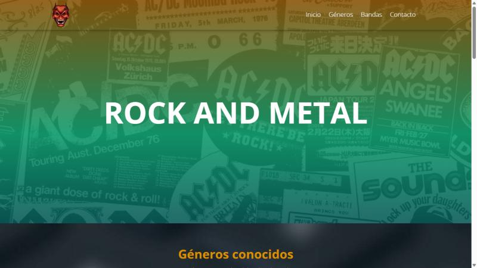
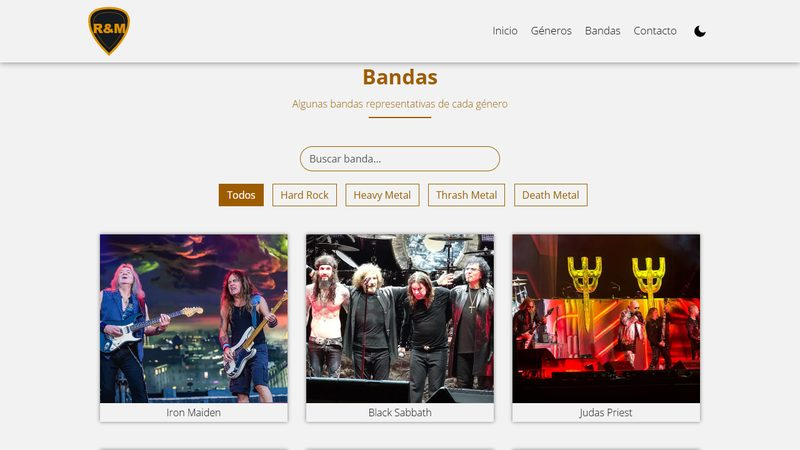
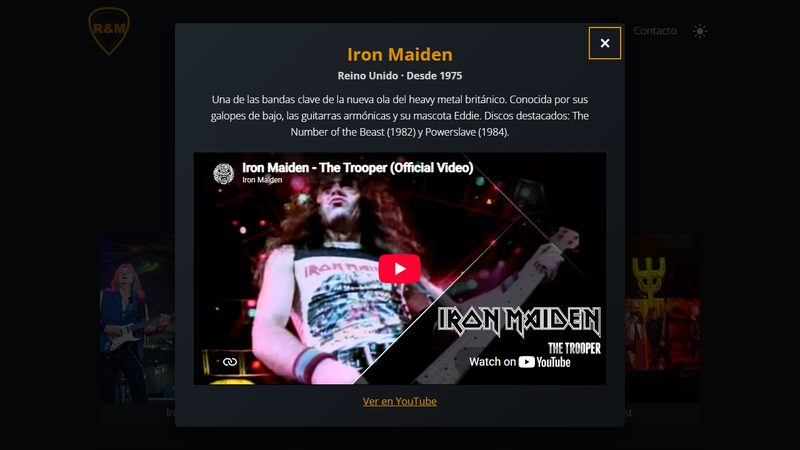
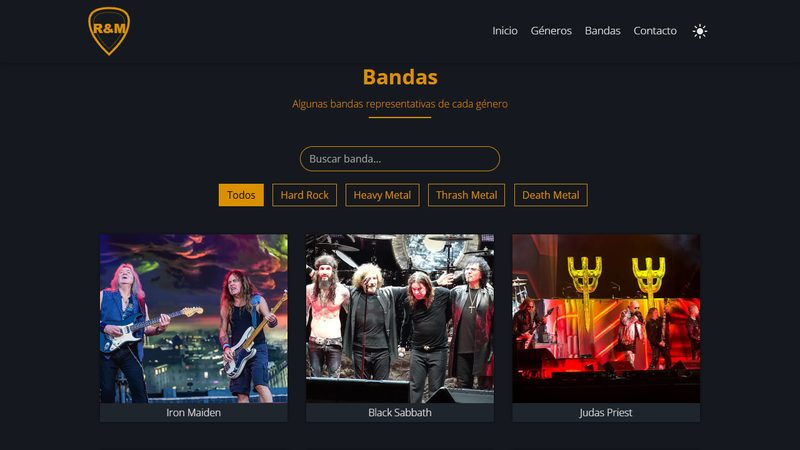

<div align="center">

# Rock and Metal

**Mi primera página web: un recorrido por los géneros y las bandas más representativas del rock y el metal.**

[](https://kesagaro.github.io/Primera-Web-Kevin/)




</div>

## Sobre el proyecto

Sitio web de una sola página que desarrollé en el colegio como mi primer proyecto web. Presenta cuatro géneros del rock y el metal y una galería de bandas que se puede filtrar por género. Hoy lo sigo mejorando para aplicar buenas prácticas de desarrollo web.

## Características

- **Galería filtrable**: once bandas organizadas en Hard Rock, Heavy Metal, Thrash Metal y Death Metal. Las tarjetas se generan con JavaScript a partir de `bandas.json`.
- **Ficha de cada banda**: al pulsar una tarjeta se abre una ventana (`<dialog>`) con el país, el año de formación, una breve reseña y un video oficial de YouTube. Se cierra con Escape, con la ✕ o haciendo clic afuera.
- **Buscador**: filtra las bandas por nombre mientras escribes y se combina con el filtro por género. No importan las tildes, las mayúsculas ni los signos (por ejemplo, "ac dc" encuentra AC/DC).
- **Modo oscuro**: botón ☀/☾ en el menú. La primera vez sigue el modo del sistema y después recuerda tu elección.
- **Animaciones al hacer scroll**: títulos, tarjetas y secciones aparecen suavemente al llegar a ellos. Si el sistema tiene activado "reducir movimiento", la página se muestra sin animaciones.
- **Página 404 propia**: si alguien entra a una dirección que no existe, ve una página con el estilo del sitio y un botón para volver al inicio.
- **Navegación con desplazamiento suave** hacia cada sección.
- **Menú adaptable**: cambia de estilo al hacer scroll y se convierte en menú lateral en pantallas pequeñas.
- **Diseño responsive** para escritorio, tablet y móvil.
- **Carga rápida**: imágenes en WebP que se cargan al acercarse, íconos SVG y fuente que no bloquea el render. Lighthouse marca 100 en rendimiento en escritorio.
- **Accesibilidad**: colores con contraste suficiente, títulos en orden, menú y filtros que se pueden usar con teclado, y texto alternativo en las imágenes. Lighthouse marca 100 en accesibilidad.
- **Lista para compartir**: favicon y etiquetas Open Graph para que el enlace muestre título, descripción e imagen en redes y chats.
- **Sin librerías**: todo el comportamiento está hecho con JavaScript nativo.

<div align="center">

<br><br>


</div>

## Tecnologías

| Tecnología | Uso |
|---|---|
| HTML5 | Estructura semántica del sitio |
| CSS3 | Estilos, variables, Grid, Flexbox, animaciones, desplazamiento suave y media queries |
| JavaScript | Menú, galería generada desde JSON con `fetch`, filtro, buscador, modo oscuro con `localStorage` y cambios al hacer scroll |
| JSON | Datos de las bandas (`bandas.json`) |
| YouTube | Videos oficiales insertados con `youtube-nocookie.com`, que solo se cargan al abrir la ficha |
| SVG | Logo propio e íconos de redes sociales de [Simple Icons](https://simpleicons.org/) (dominio público, CC0) |
| Google Fonts | Tipografía Open Sans |

## Estructura

```
Primera-Web-Kevin/
├── index.html          # Página principal
├── 404.html            # Página de error cuando una dirección no existe
├── estilos.css         # Estilos del sitio
├── bandas.json         # Datos de las bandas de la galería
├── js/
│   ├── tema.js         # Modo claro / oscuro
│   ├── main.js         # Menú y cambios al hacer scroll
│   ├── animaciones.js  # Animaciones al hacer scroll
│   └── filtro.js       # Galería, ficha, filtro y buscador
├── img/                # Imágenes del sitio
└── docs/               # Capturas para este README
```

## Cómo ejecutarlo

1. Clona el repositorio:

   ```bash
   git clone https://github.com/Kesagaro/Primera-Web-Kevin.git
   cd Primera-Web-Kevin
   ```

2. Levanta un servidor local:

   ```bash
   python -m http.server 5500
   ```

   y entra a <http://localhost:5500>.

No necesita instalación ni dependencias. La galería se carga con `fetch`, así que abrir `index.html` con doble clic no muestra las bandas: hace falta el servidor local (o la versión publicada en GitHub Pages).

### Agregar una banda

1. Guarda la foto en `img/` en formato WebP.
2. Agrega un objeto en `bandas.json`:

   ```json
   {
       "nombre": "Nombre de la banda",
       "genero": "heavy-metal",
       "imagen": "img/nombre-de-la-banda.webp",
       "alt": "Banda Nombre de la banda",
       "ancho": 810,
       "alto": 540,
       "pais": "País",
       "formacion": 1980,
       "descripcion": "Reseña corta de la banda.",
       "video": {
           "id": "ID_DEL_VIDEO",
           "titulo": "Nombre de la canción"
       }
   }
   ```

   `genero` debe ser `hard-rock`, `heavy-metal`, `thrash-metal` o `death-metal`, igual que en los botones del filtro. `ancho` y `alto` son las medidas de la foto en píxeles. `video.id` es lo que va después de `watch?v=` en el enlace de YouTube; usa un video del canal oficial de la banda o de su disquera.
3. Si la foto no es tuya, agrega su crédito en la sección de abajo.

## Créditos de imágenes y videos

Todas las fotos son de Wikimedia Commons, con licencia Creative Commons, y están redimensionadas para el sitio.

Los videos no están alojados en este repositorio: se insertan desde los canales oficiales de cada banda o de su disquera en YouTube, y sus derechos pertenecen a sus autores.

**Galería**

- `img/iron-maiden.webp`: [Iron Maiden – Tons of Rock 2026](https://commons.wikimedia.org/wiki/File:Iron_Maiden_%E2%80%93_Tons_of_Rock_2026.jpg), por Birgit Fostervold, licencia [CC BY-SA 4.0](https://creativecommons.org/licenses/by-sa/4.0/).
- `img/black-sabbath.webp`: [Black Sabbath (2013)](https://commons.wikimedia.org/wiki/File:Black_Sabbath_(2013).jpg), por Robson Batista, licencia [CC BY 2.0](https://creativecommons.org/licenses/by/2.0/).
- `img/judas-priest.webp`: [Judas Priest - Wacken Open Air 2018 01](https://commons.wikimedia.org/wiki/File:Judas_Priest_-_Wacken_Open_Air_2018_01.jpg), por Frank Schwichtenberg, licencia [CC BY-SA 4.0](https://creativecommons.org/licenses/by-sa/4.0/).
- `img/ac-dc.webp`: [AC DC at London's Olympic Stadium](https://commons.wikimedia.org/wiki/File:AC_DC_at_London%27s_Olympic_Stadium.jpg), por Egghead06, licencia [CC BY-SA 4.0](https://creativecommons.org/licenses/by-sa/4.0/).
- `img/guns-n-roses.webp`: [GNR London Stadium 2017 3 (cropped)](https://commons.wikimedia.org/wiki/File:GNR_London_Stadium_2017_3_(cropped).jpg), por Raph_PH, licencia [CC BY 2.0](https://creativecommons.org/licenses/by/2.0/).
- `img/led-zeppelin.webp`: [LedZeppelinChicago75](https://commons.wikimedia.org/wiki/File:LedZeppelinChicago75.jpg), por more19562003, licencia [CC BY 2.0](https://creativecommons.org/licenses/by/2.0/).
- `img/slayer.webp`: [Slayer - band - live 2006](https://commons.wikimedia.org/wiki/File:Slayer_-_band_-_live_2006.jpg), por Gabriele (recorte de JD), licencia [CC BY 2.0](https://creativecommons.org/licenses/by/2.0/).
- `img/testament.webp`: [Testament band](https://commons.wikimedia.org/wiki/File:Testament_band.jpg), por Rockman, licencia [CC BY 3.0](https://creativecommons.org/licenses/by/3.0/).
- `img/death.webp`: [Death Mexico 06-89](https://commons.wikimedia.org/wiki/File:Death_Mexico_06-89.jpg), por A Sniper, licencia [CC BY-SA 3.0](https://creativecommons.org/licenses/by-sa/3.0/).
- `img/cannibal-corpse.webp`: [CannibalCorpse](https://commons.wikimedia.org/wiki/File:CannibalCorpse.jpg), por Chris Buresh, licencia [CC BY 2.0](https://creativecommons.org/licenses/by/2.0/).
- `img/morbid-angel.webp`: [Morbid Angel - Geiselwind 2012](https://commons.wikimedia.org/wiki/File:Morbid_Angel_-_Geiselwind_2012.jpg), por Voltago, licencia [CC BY 3.0](https://creativecommons.org/licenses/by/3.0/).

**Fondo del encabezado**

- `img/fondo.webp`: [Metal crowd](https://commons.wikimedia.org/wiki/File:Metal_crowd.jpg), por WanderingTrad, licencia [CC BY-SA 4.0](https://creativecommons.org/licenses/by-sa/4.0/).

El logo y los degradados de fondo son de creación propia.

## Autor

**Kevin Santiago Garzon Romero**

[](https://github.com/Kesagaro)
[](https://www.youtube.com/@Paradoxx_02)
